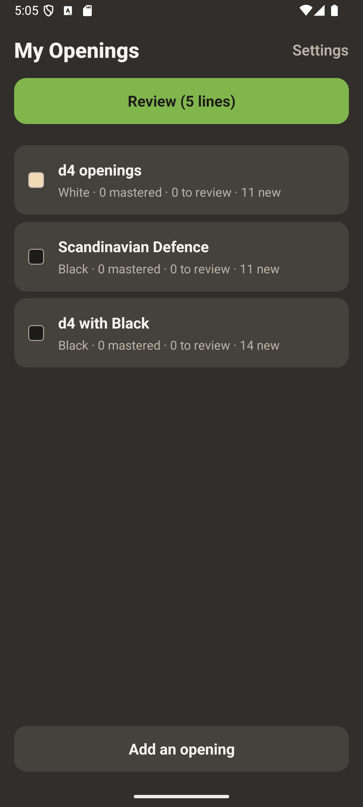
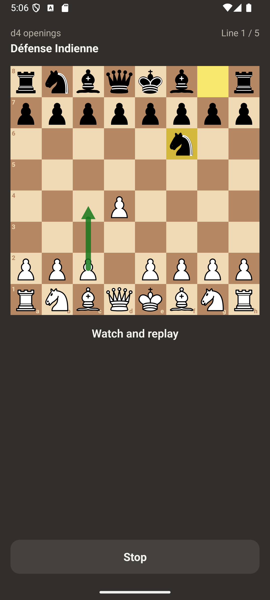
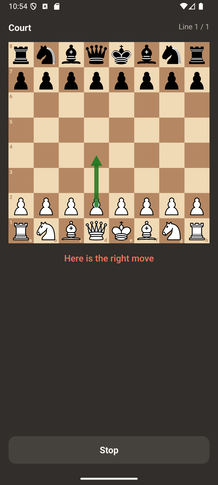

# Mes Ouvertures

A personal chess opening trainer for Android, made with React Native: drill your own repertoire line by line on a
board, with spaced repetition. The openings come from the author's own read-only openings API (managed in a web
editor); its address is private configuration, kept out of this repository. The app speaks French and English (it
follows the phone's language; you can change it in the settings).

## Screenshots

<!-- factory:screenshots:start -->
<p>
  
  
  
</p>
<!-- factory:screenshots:end -->

## Play

No APK is published: a release build contains the address of the openings API it reads. Build it yourself (below)
with your own API, then install it on an Android phone (allow installation from unknown sources). Without an API
the app shows its 3 embedded repertoires.

## Privacy

- No account, no ads, no personal data, no statistics, no crash reports.
- At launch the app downloads the openings from the configured API with plain GET requests (no identifier, no
  cookie); this is why it needs the INTERNET permission. Your progress stays on the phone and is never sent.

## Build from source

Requirements: Node.js 20+, JDK 17, Android SDK.

```bash
npm install
npm test
```

Openings API: copy `src/config/env.ts` to `src/config/env.local.ts` (git-ignored) and set `OPENINGS_API_BASE_URL`
to your API (`GET /api/openings`, `GET /api/openings/{id}`, see `mock-api/contract.cjs` and `docs/PRD.md`). The
release build uses that file; the committed placeholder is `https://example.invalid`.

Release signing reads `FACTORY_STORE_FILE`, `FACTORY_STORE_PASSWORD`, `FACTORY_KEY_ALIAS` and
`FACTORY_KEY_PASSWORD` from your user-level `~/.gradle/gradle.properties`; without them the release build is
signed with the debug key.

## Project docs

- [Product requirements](docs/PRD.md)
- [Architecture decisions](docs/adr/)
- [Verification evidence](docs/evidence/)
