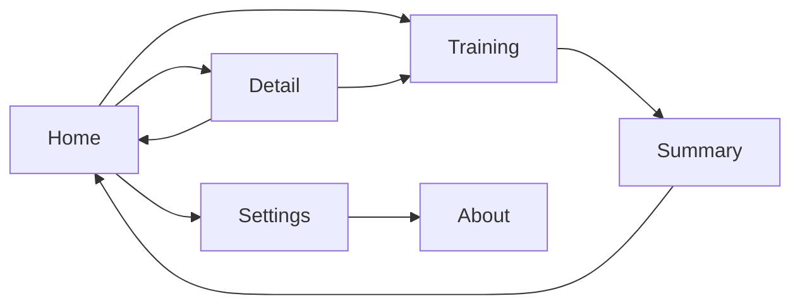

# PRD: Mes Ouvertures

Status: approved
Project slug: chess-opening-trainer
Final app name: Mes Ouvertures
Android package: io.github.nhilaire.chessopeningtrainer
Version target: 0.3.0
Last updated: 2026-11-08

> v0.2.0 amendment (after the v0.1.0 phone test): no daily limit on new lines; « Réviser » and « S'entraîner sur
> cette ouverture » queue every line of their scope in random order (new lines still in discovery mode); a line
> played before its due date only moves when it is failed. Amended: core loop, home, rules "Spaced repetition" and
> "Session queue", persistence, AC-16..AC-20, AC-25, AC-30, `home.nothing`. Also a new Scandinavian line (7. h3) and
> embedded openings updated on existing installs (criterion 39 of v0.2.0, removed in v0.3.0).

> v0.3.0 amendment (user request, replaces v0.2.0 which was not accepted): the openings come from the user's own
> read-only openings API (section "Openings API"); the API response overwrites the stored openings, the embedded
> ones are only the offline first-launch seed; openings are read-only on the phone (no PGN import, rename or
> delete); in review any repertoire move of the player is accepted and the line continues in the chosen branch;
> after the second wrong move every expected move gets an arrow. Removed: PGN import rules, Import screen,
> criteria 07 to 14 (import, rename, delete) and 39 of v0.2.0 (numbers not reused). Amended: summary, screens, repertoire model, embedded openings, playing a line,
> persistence, non-functional, AC-04..AC-06, AC-20, AC-22, AC-26, AC-36, AC-37, copy. New: AC-40..AC-50 (icon and splash).

> Written in English. Player-facing text is quoted in the "Player copy" section, in every language of the game
> (`factory-app.json` "languages"; French is the reference).
> Status becomes `approved` only after the user explicitly approves this document.

## Summary

Mes Ouvertures (English: My Openings) is a personal chess opening trainer. The player keeps their own repertoire
in their own web editor, which publishes it through a read-only API; the app downloads it at launch, keeps it on
the phone for offline use (3 repertoires ship in the APK for a first launch offline) and drills it line by line on a
board: the app plays the opponent's moves, the player must find their own. Spaced repetition decides
which lines come back: a failed line returns the same day, a known line is spaced out over weeks. It improves on the
user's earlier Angular PWA (random lines, no memory, hard-coded openings).
Pitch: « Construis ton répertoire d'ouvertures et répète-le quelques minutes par jour. »

## Target players

- Mostly the user themself: an adult club/online chess player who knows algebraic notation. Public on GitHub.
- A few minutes per day, one hand or two, anywhere (offline). Portrait.
- Accessibility: legal destinations and arrows must be visible on both square colours; text readable at the
  system font size.

## Core loop

1. Open the app: the home screen shows per opening how many lines are mastered, to review and new.
2. Tap « Réviser »: the app plays every line of every opening in random order (or one opening from its detail).
3. Play the line: the app plays the opponent's moves, the player plays theirs; new lines are first shown with arrows.
4. Result: a due line succeeded is spaced out, any failed line goes back to review; next line.
5. Session summary when the queue is empty or the player stops.

## Use cases

| ID | As a player I want to... | So that... |
|---|---|---|
| UC-01 | open the app the first time and find the 3 embedded repertoires ready | I can train without setup |
| UC-02 | train every line of every opening in random order with one tap | I keep my whole repertoire alive |
| UC-03 | train one chosen opening | I can focus before a tournament or after editing it in my web editor |
| UC-04 | be shown a new line before being quizzed on it | I learn it instead of guessing |
| UC-05 | get a second try and then the answer when I play a wrong move | I learn without frustration |
| UC-06 | find at launch the openings I added or changed in my web editor | I edit my repertoire in one place |
| UC-07 | keep training offline with the last openings downloaded | the app works anywhere |
| UC-08 | see per opening how many lines are mastered, to review and new | I know where I stand |
| UC-09 | find my progress intact after closing the app or restarting the phone | repetition works over days |
| UC-10 | switch language, sound and vibration in the settings | the app fits me |
| UC-11 | read why the app exists in « À propos » | I know its story |

## Screens

No consent screen: the app collects nothing (`firebase: none`).

- **Home**: big « Réviser » button with the number of lines of all openings (disabled with « Rien à réviser »
  when there is no line); list of openings (name, colour played, mastered / to review / new counts) in the order of
  the API list (embedded seed: d4 White, Scandinavian, d4 Black); settings icon; while the API refresh runs a small
  line « Mise à jour des ouvertures… » under the title (the home stays usable); after a failed refresh a small line
  « Mise à jour impossible : dernières ouvertures enregistrées » until the next launch. When there is no opening, the list shows
  `home.empty` and the « Réviser » button is disabled.
- **Opening detail** (tap on an opening): name, colour, counts, number of lines, « S'entraîner sur cette ouverture »,
  « Retour ». Read-only: openings are managed in the web editor.
- **Training**: board (flipped when the player has Black), opening name and line label, prompt line (« À toi de
  jouer », « Regarde et rejoue », « Pas ce coup-là, réessaie », « Voici le bon coup » / « Voici les bons coups »), progress « Ligne 3 / 12 »,
  « Arrêter » button. After each line a short result banner (« Ligne réussie », « Ligne à revoir », or
  « Ligne apprise » after a discovery) and « Suivante ».
- **Session summary**: lines succeeded, lines to review again, new lines learnt; « Retour à l'accueil ».
- **Settings**: language (Automatique / Français / English), sound on/off, vibration on/off, « À propos » link.
- **About** (« À propos »): story, made by a passionate independent developer, version, piece set credit and licence.

## Rules and scoring

### Repertoire model
- An **opening** = id, name, colour played (white|black), a move tree from the standard start position. Tree node:
  `move` (SAN), optional `name`, optional `children` (none = end of a line). Moves are replayed with the chess rules
  library from the start position; ids of moves are the library's SAN (castling `O-O`, check signs as the library
  writes them).
- A **line** = a path from the start position to a leaf of the tree. Its id is `<colour played>|<SAN sequence>` (e.g.
  `black|e4 d5 exd5 Qxd5`): it does not depend on the opening id, so progress survives an opening renamed, re-created
  or a line moved to another opening of the same colour; the same line in two openings of the same colour shares
  its progress (it is listed and queued once per opening). Its **label** is the last `name` met along its path
  (e.g. « Scandinave d'avance »), otherwise the opening name. Names are data: shown as written, not translated.
- **Tree order** = depth-first, children in API order.
- **Player moves** of a line = moves of the player's colour; **opponent moves** = the others. A line that has no
  player move is ignored.
- Openings are read-only on the phone: no import, rename or delete (they are managed in the web editor).

### Openings API
- Base URL `OPENINGS_API_BASE_URL`: only in the git-ignored local config `src/config/env.local.ts` (privateConfig);
  the committed `src/config/env.ts` holds `https://example.invalid`, the e2e build targets the mock API. The real
  address never appears in a tracked file, a test, a fixture, the README or a GitHub release (the APK holds it, so the
  APK is never attached to a release).
- At each launch, in the background (the home screen is usable at once with the stored openings):
  `GET /api/openings` (list: `id`, `name`, `playerColor`, ...), then `GET /api/openings/{id}` for every listed
  opening (`id`, `name`, `playerColor`, `tree`). Each request sends the ETag stored for that URL in `If-None-Match`
  when there is one; `304 Not Modified` means the stored copy of that URL is still valid. Timeout 45 s per request
  (the free server may wake up slowly).
- Shapes (the mock `mock-api/contract.cjs` is the executable reference): the list is a top-level JSON array of
  objects with a string `id`; a detail is an object with `id`, `name` (string), `playerColor` (`white`|`black`) and
  `tree`, an array of root nodes (the first moves); a node is `{ move: string, name?: string, children?: node[] }`.
  Other fields (`description`, `variants`, `lineCount`, `updatedAt`...) are ignored. The id goes in the path
  URL-encoded. Two sibling nodes with the same move (after SAN normalisation) are merged (children concatenated,
  first `name` kept).
- An opening is **valid** when its detail has that shape, every move is legal from the start position and at least
  one line has a player move.
- **Success** = the list and every detail answered (200, or 304 with a stored copy of that URL): the stored openings
  are replaced by the valid API openings, in list order, with the new ETags. Invalid openings are skipped (home shows
  `home.partial` with their number until the next refresh). Nothing else is kept: the embedded seed and any opening
  imported with an older version disappear.
- **Failure** (no network, timeout, any other status on the list or a detail, the list not an array, a 304 without
  stored copy): the stored openings and ETags are unchanged, no dialog; home shows `home.offline` until the next
  launch, which tries again.
- A refresh that ends during a training session does not change it: the session keeps the lines it started with,
  their results are saved by line id; home, detail and the next session use the new openings. An open detail screen
  whose opening disappeared goes back to home.
- First launch (nothing stored) or corrupt storage: the embedded seed is stored first, then the refresh runs.
- Line progress is keyed by line id and never deleted by a refresh: a line that disappeared is ignored (not counted,
  not queued) and gets its progress back if it reappears with the same moves.

### Embedded openings (offline seed)
- The 3 repertoires of the PWA as converted in v0.2.0 (with the Scandinavian 7. h3 line), with the ids of the API:
  `ouvertures-en-d4` (White), `defense-scandinave` (Black), `ouvertures-d4-noirs` (Black). Names while they are
  shown: « Ouvertures en d4 » / "d4 openings", « Défense Scandinave » / "Scandinavian Defence", « d4 avec les
  Noirs » / "d4 with Black" (follow the UI language; renames of v0.1.0/v0.2.0 are dropped).
- Upgrade from v0.1.0/v0.2.0: stored progress keys `<opening id>|<moves>` are rewritten `<colour of that opening>|<moves>`
  once (keys of an opening no longer stored are dropped); when two old keys give the same new key, the one with the
  higher box is kept.

### Spaced repetition (per line, Leitner boxes)
- States: **new** (never learnt), then **box 1..6**. Interval by box in days: 1, 3, 7, 14, 30, 60.
- Dates are local calendar days. A line in a box is **due** when its due date <= today.
- New line, discovery finished → box 1, due tomorrow (discovery counts as learnt, not as a success).
- Due line succeeded (no failed player move) → box = min(box + 1, 6), due = today + interval(new box).
- Learnt line not due yet, succeeded → unchanged (training ahead of time never stretches the interval).
- Learnt line failed (at least one move failed, see below), due or not → box 1, due today; it is put back at the end of the
  current session queue once (a second failure in the same session keeps it due today, not re-queued again).
- A line that already failed today and is then succeeded (re-queued attempt or a later session the same day) →
  box 1, due tomorrow (never better than a plain success). In the session summary each line counts once: « à
  revoir » if it failed at least once in the session, else « réussie » (or « apprise » for a discovery).
- **Mastered** = box >= 4. **To review** = learnt and due date <= today (overdue included). **New** = never learnt.
- No limit on new lines: every line is available from the first launch.

### Session queue
- « Réviser » (home): every line of every opening, in a random order drawn at the start of the session (uniform
  shuffle); a new line is played in discovery mode, a learnt one in review mode.
- « S'entraîner sur cette ouverture »: the same rule restricted to that opening; always enabled when it has a line.
- « Réviser » is disabled and shows « Rien à réviser » only when there is no line at all.
- Each finished line is saved immediately; « Arrêter » leaves the current line unchanged and opens the summary.
  Android Back during a line does the same as « Arrêter »; killing the app mid-line leaves the line unchanged.

### Playing a line
- The board starts at the start position, oriented for the player's colour. If the player has Black, the app plays
  White's first move.
- Opponent moves are played automatically 400 ms after the player's move (with move animation).
- Input: tap a piece then a destination, or drag; the selected square and its legal destinations are highlighted.
  An illegal move snaps back and counts for nothing. Promotion shows a picker (Q, R, B, N).
- **Discovery** (new line): before each player move a green arrow shows the move to play; only that move is
  accepted (others snap back with « Joue le coup indiqué »). No failure is possible.
- **Review**: every learnt line of the queue is a target. Opponent moves: while the position is on the target's path
  the opponent plays the target's move; once the player has left it, the opponent picks one of the repertoire moves
  at random, weighted by the number of lines under each move not yet finished in this session (by all its lines when
  none is left). Player moves: any repertoire move from the position (any child of the current node) is correct and
  the line continues in that branch. Any other legal move: 1st time « Pas ce coup-là, réessaie » (move undone, error
  sound/vibration); 2nd time on the same move a green arrow shows every repertoire move from the position, the line
  is **failed** and the player must play one of them to continue.
- The line **finished** is the leaf reached (not necessarily the target): its result updates its own progress; the
  target's progress is unchanged when another leaf is reached. A never-learnt line reached this way counts as learnt
  (box 1, due tomorrow; « apprise » in the summary) when succeeded, and as failed (box 1 due today, « à revoir »)
  when failed. A finished line still waiting later in the queue is removed from it, so the total of « Ligne i / N »
  can go down. A failed line is re-queued once (the line reached, as a review target).
- End of line (leaf reached): result banner (« Ligne réussie », « Ligne à revoir » or « Ligne apprise »), then « Suivante » starts the next queued line, or the summary when the
  queue is empty.

### Persistence
- Saved locally (on the phone only): the openings of the last successful API refresh (or the embedded seed), the
  ETag of each API URL, per-line state (box, due date, learnt date), settings (language, sound, vibration). Survives
  app restart and an app update.

## Look, sound and feel

- Board: light `#f0d9b5` / dark `#b58863` squares, coordinates on the edge, last move highlight
  `rgba(255,255,0,0.4)`, green arrows `#15781B`, app background `#312e2b` (from the existing PWA).
- Pieces: Lichess "cburnett" SVG set (CC BY-SA 3.0, Colin M.L. Burnett), credited in « À propos » and README. No
  copyrighted chess.com assets.
- Sounds (free licence or generated): move, capture, error, line succeeded; all off with the sound setting.
- Vibration: short pulse on a wrong move; off with the vibration setting.
- Animations: piece moves ~150 ms; no other effects. Portrait only.
- Icon and splash (v0.3.0, user request): the cburnett white knight on a corner of the app's board with the green
  arrow making a knight's move; adaptive icon (board background, knight + arrow foreground in the safe zone,
  monochrome silhouette); splash = the same emblem on the app background `#312e2b`. Drawn by
  `scripts/generate-icons.mjs`, no other asset.

## Telemetry events

None. `factory-app.json` has `firebase: none`: no Firebase, no consent screen, no analytics, no crash reporting.
Nothing leaves the phone.

| Event | When | Params | Feeds KPI |
|---|---|---|---|
| (none) | | | |

## KPIs

No telemetry, so no KPI is measured remotely. Success is judged by the user's own use: they train most days and
the number of mastered lines grows (visible on the home screen). Crash-freeness is proven at verification
(logcat, Maestro) instead of Crashlytics.

## Non-functional requirements

- Performance: smooth on a mid-range Android phone; a move answer (opponent move or feedback) starts within 500 ms;
  cold start < 3 s (the API refresh never delays the home screen).
- APK size (arm64): target < 40 MB.
- Works offline with the last stored openings. No account. No ads. Network: only GET requests to the openings API
  at launch; no Firebase or analytics dependency; AD_ID permission removed. Cleartext HTTP only to localhost (mock).
- Android: minSdk from the stack defaults; portrait only.
- Privacy: no telemetry, no personal data sent (the requests carry no identifier); the API address is private config.
- Game logic (API parser and validation, repertoire tree, repetition scheduler, session queue, move checking) is pure TypeScript
  with unit tests; chess legality may use a small MIT/BSD chess rules library (decided in the stack ADR).

## Acceptance criteria

Each criterion is testable and tagged with its proof: `[unit]` Jest, `[e2e]` Maestro flow, `[device]` check on the
phone, `[manual]` human judgement (keep these rare).

Languages
- AC-01 [unit] Given a phone in French / in English / in an unsupported language (e.g. German), then the UI is in
  French / English / English.
- AC-02 [e2e] Given the settings, when the player picks another language, then the whole UI switches at once and
  the choice survives a restart; « Automatique » follows the phone again.
- AC-03 [device] The name under the icon is « Mes Ouvertures » on a French phone and "My Openings" on an English one.

First launch and repertoire
- AC-04 [e2e] Given a first launch with the mock API offline, when the app opens, then the home screen lists the 3
  embedded openings with their colour and counts, without any consent screen, and shows the offline line.
- AC-05 [unit] Given the embedded seed, then every move is legal, the lines equal the leaves of the PWA source trees
  (with the 7. h3 Scandinavian line) and the ids are the API ids.
- AC-06 [unit] Given a tree, then lines are the paths start→leaf, their label is the last `name` on the path (else
  the opening name) and lines without a player move are ignored.

- AC-36 [unit] Given an API list with no opening, then home shows `home.empty` and « Réviser » is disabled.
- AC-37 [unit] Given the embedded seed, then its names follow the UI language; given API openings, their names and
  labels are shown exactly as the API writes them, in every language.

Openings API
- AC-40 [unit] Given a refresh where the list and every detail answer 200 with valid data, then the stored openings
  are exactly the API openings in list order (embedded seed and older imported openings gone) and the ETags are
  stored; given 304 answers to the If-None-Match ETags, then the stored copies are kept.
- AC-41 [unit] Given a refresh that fails (network error, timeout, status 500 on the list or a detail, invalid JSON,
  a 304 without stored copy answered 304 again on its retry), then the stored openings and ETags are unchanged and
  home shows `home.offline`; given one detail with an illegal move, an unknown colour or no player move, then the
  other openings are stored, that one is skipped and home shows `home.partial` (1); sibling nodes with the same move
  are merged; extra fields are ignored. (Amended 2026-11-08 with the user, v0.3.1: a 304 without stored copy, or a 304
  on the list without stored list ids, is fetched again once without `If-None-Match`, and the refresh only fails if
  that retry answers 304 again; an opening listed twice and answered 304 is kept once; an ETag is not kept when its
  opening could not be stored, and is dropped when a later store of it fails.)
- AC-42 [unit] Given the API client, then every request is a GET with a 45 s timeout and the stored ETag in
  `If-None-Match`; no request carries an identifier.
- AC-43 [e2e] Given the mock API serving a test repertoire, when the app is launched, then home shows the API
  openings with their names and line counts; when the mock later serves a changed repertoire (an opening added, one
  removed, a line added), then after a restart home shows the change; when the mock is offline, then after a
  restart home still shows the last openings and the offline line, and a line can be trained.
- AC-44 [e2e] Given the mock API slow (10 s) at launch, then home shows the stored openings at once with
  « Mise à jour des ouvertures… », and the API openings once the answer arrives.
- AC-45 [unit] Given stored v0.2.0 data (progress keys `<opening id>|moves`), when loaded, then the keys become
  `<colour>|moves` (higher box kept on a clash); given a line moved to another opening of the same colour, then its
  progress follows it; given progress of a line no longer in any opening, then it is kept
  in storage, not counted and not queued, and counted again if the line comes back.
- AC-46 [unit] Given review mode at a position with two repertoire moves for the player (e.g. 4...Bb4 then cxd5 or
  Bg5), when the player plays either, then it is accepted and the line continues in that branch; the finished line is
  the leaf reached and its progress is updated, not the target's; a reached line still queued later is removed from
  the queue; a never-learnt line reached and succeeded counts as « apprise »; a failed reached line is re-queued once.
- AC-50 [manual] On the phone, the launcher icon shows the knight, its board and the green arrow (adaptive, readable
  in the round mask) and the app opens on a splash with the same emblem on the dark background, without a white flash.
- AC-49 [unit] Given a refresh that completes during a session, then the session's remaining lines are unchanged;
  given the detail screen of an opening that the refresh removed, then the app goes back to home.
- AC-47 [unit] Given review mode once off the target's path, then the opponent's move is drawn with weights equal to
  the lines not yet finished in the session under each move (injected random source), all lines when none is left.
- AC-48 [device] The committed files and the git history contain no real API address (secret scan with the private
  host of `privateConfig` as a term); the e2e APK targets the mock only; the prod APK holds the private host (both
  checked by build-apk); RELEASE.md and the publish step record that no APK is attached to the public GitHub repo.

Spaced repetition and sessions
- AC-15 [unit] Given a line in box b, when it is succeeded, then its box is min(b+1, 6) and its due date is today +
  1/3/7/14/30/60 days for box 1..6; when it is failed, then it goes to box 1 due today; when a line already failed
  today is then succeeded, it goes to box 1 due tomorrow and the session summary counts it once as « à revoir ».
- AC-16 [unit] Given a new line, when its discovery is finished, then it is in box 1 due tomorrow; there is no
  daily limit: on a first launch every line of the 3 embedded openings is queued by « Réviser ».
- AC-17 [unit] Given new, due and not-yet-due lines, then the « Réviser » queue holds every line exactly once, in an
  order given by the injected random source (two sources give two orders), new lines in discovery mode and learnt
  ones in review mode; a line failed in the session is re-queued once at the end.
- AC-18 [unit] Given an opening whose lines are all learnt and not due, when « S'entraîner sur cette ouverture » is
  used, then all its lines (and only them) are queued; a not-due line succeeded keeps its box and due date, a
  not-due line failed goes to box 1 due today.
- AC-19 [unit] Given line states, then counts are: mastered = box >= 4, to review = learnt with due date <= today,
  new = never learnt;
  the home « Réviser » count equals the number of lines of all openings.
- AC-20 [e2e] Given an API list with no opening, then the « Réviser » button is disabled and shows « Rien à réviser »;
  on a first launch it shows the number of lines of the 3 embedded openings.

Playing a line
- AC-21 [unit] Given the player has Black, when the line starts, then the app plays White's first move and the board
  is flipped.
- AC-22 [unit] Given review mode, when the player plays a repertoire move, then it is accepted and the opponent's
  reply follows; another legal move: 1st time retry, 2nd time an arrow on every repertoire move and line failed; an
  illegal move changes nothing.
- AC-23 [unit] Given discovery mode, then an arrow shows each player move, only that move is accepted and the line
  cannot be failed.
- AC-24 [unit] Given a position with a promotion, then the chosen piece is applied and compared with the line's SAN.
- AC-25 [e2e] Given a new opening line, when the player starts training it, follows the arrows (tap-tap) to the end,
  then « Ligne apprise » and « Suivante » are shown and the summary counts the line as learnt.
- AC-26 [e2e] Given a due line, when the player plays a wrong move twice, then « Pas ce coup-là, réessaie » then
  the arrows (one per repertoire move) and « Voici le bon coup » (« Voici les bons coups » when there are several) are shown, and the summary counts the line as to review.
- AC-27 [manual] Dragging a piece on the phone feels natural and precise, highlights are visible on both square
  colours.
- AC-28 [e2e] Given a session, when the player taps « Arrêter » or Android Back, then the summary opens and the
  current unfinished line keeps its previous state; killing the app mid-line also leaves it unchanged (AC-29).

Persistence and settings
- AC-29 [e2e] Given lines learnt in a session, when the app is killed and restarted, then the home counts and the
  next due dates are unchanged.
- AC-30 [unit] Given saved state from the store, when it is loaded, then openings, line states and settings
  are restored (a daily counter saved by v0.1.0 is ignored); corrupt data falls back to the embedded openings without crashing.
- AC-31 [e2e] Given the settings, when sound or vibration is switched off, then the choice survives a restart (and
  no sound / vibration is triggered, checked by unit test of the feedback module).
- AC-32 [e2e] Given the « À propos » screen, then it shows the story text `about.story`, « made by a passionate
  independent developer », the app version and the piece set credit.

Quality
- AC-33 [device] Cold start to a usable home screen < 3 s on the phone.
- AC-34 [e2e] No crash and no fatal error in logcat during all Maestro flows.
- AC-35 [device] The release build has no telemetry module and no Firebase or analytics dependency
  (`package.json`), and the merged release manifest (`aapt dump permissions` on the APK) has no AD_ID permission.
- AC-38 [unit] Given counts of 0, 1 and 2, then plural strings read « 0 ligne / 1 ligne / 2 lignes » in French and
  "0 lines / 1 line / 2 lines" in English (same for home and summary counts).

## Player copy

Final app name: « Mes Ouvertures » (fr), "My Openings" (en). No image with text, no spoken audio: no per-language
asset. Chess notation is standard SAN (K Q R B N) in both languages. French tone: tu.
Plurals: strings with a count have a singular form (fr: 0 and 1, en: 1) and a plural form; the table shows the
plural, the singular drops the s (« 1 ligne », « 1 maîtrisée », "1 line").

| Key | fr | en |
|---|---|---|
| home.review | Réviser ({count} lignes) | Review ({count} lines) |
| home.nothing | Rien à réviser | Nothing to review |
| home.empty | Aucune ouverture. Ajoute-en depuis ton éditeur. | No opening yet. Add some in your editor. |
| home.updating | Mise à jour des ouvertures… | Updating openings… |
| home.offline | Mise à jour impossible : dernières ouvertures enregistrées | Could not update: last saved openings |
| home.partial | {count} ouvertures illisibles ignorées | {count} unreadable openings skipped |
| home.counts | {mastered} maîtrisées · {due} à revoir · {new} nouvelles | {mastered} mastered · {due} to review · {new} new |
| color.white | Blancs | White |
| color.black | Noirs | Black |
| detail.train | S'entraîner sur cette ouverture | Train this opening |
| detail.lines | {count} lignes | {count} lines |
| train.yourMove | À toi de jouer | Your move |
| train.discover | Regarde et rejoue | Watch and replay |
| train.playArrow | Joue le coup indiqué | Play the move shown |
| train.wrong | Pas ce coup-là, réessaie | Not that move, try again |
| train.answer | Voici le bon coup | Here is the right move |
| train.answers | Voici les bons coups | Here are the right moves |
| train.progress | Ligne {index} / {total} | Line {index} / {total} |
| train.stop | Arrêter | Stop |
| train.success | Ligne réussie | Line succeeded |
| train.failed | Ligne à revoir | Line to review |
| train.learnt | Ligne apprise | Line learnt |
| train.next | Suivante | Next |
| summary.title | Séance terminée | Session complete |
| summary.counts | {ok} réussies · {failed} à revoir · {learnt} nouvelles apprises | {ok} succeeded · {failed} to review · {learnt} new learnt |
| summary.home | Retour à l'accueil | Back to home |
| settings.title | Réglages | Settings |
| settings.language | Langue | Language |
| settings.auto | Automatique | Automatic |
| settings.sound | Sons | Sounds |
| settings.vibration | Vibrations | Vibrations |
| settings.about | À propos | About |
| about.story | Mes ouvertures s'envolaient dès que je ne les révisais plus. Après une première version web, j'ai créé Mes Ouvertures pour construire mon propre répertoire et le répéter quelques minutes par jour. | My openings slipped away as soon as I stopped reviewing them. After a first web version, I made My Openings to build my own repertoire and repeat it a few minutes a day. |
| about.madeBy | Créé par un développeur indépendant passionné. | Made by a passionate independent developer. |
| about.version | Version {version} | Version {version} |
| about.pieces | Pièces « cburnett » de Colin M.L. Burnett, licence CC BY-SA 3.0 | "cburnett" pieces by Colin M.L. Burnett, CC BY-SA 3.0 licence |
| opening.d4 | Ouvertures en d4 | d4 openings |
| opening.scandinavian | Défense Scandinave | Scandinavian Defence |
| opening.d4Black | d4 avec les Noirs | d4 with Black |

## Out of scope

- Editing openings on the phone (import, rename, delete): done in the web editor. Building or deploying the API.
- Analysis engine (Stockfish, evaluation), building a line move by move on the board, editing a tree.
- Accounts, sync of progress, cloud backup, PGN import or export.
- Telemetry of any kind, ads, purchases, iOS, landscape, streaks, statistics history.
- Start positions other than the standard one (FEN).

## Open questions

None
