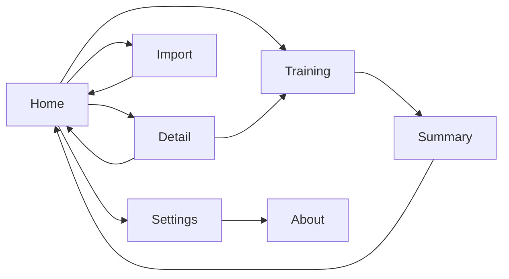

# PRD: Mes Ouvertures

Status: approved
Project slug: chess-opening-trainer
Final app name: Mes Ouvertures
Android package: io.github.nhilaire.chessopeningtrainer
Version target: 0.2.0
Last updated: 2026-11-03

> v0.2.0 amendment (after the v0.1.0 phone test): no daily limit on new lines; « Réviser » and « S'entraîner sur
> cette ouverture » queue every line of their scope in random order (new lines still in discovery mode); a line
> played before its due date only moves when it is failed. Amended: core loop, home, rules "Spaced repetition" and
> "Session queue", persistence, AC-16..AC-20, AC-25, AC-30, `home.nothing`.

> Written in English. Player-facing text is quoted in the "Player copy" section, in every language of the game
> (`factory-app.json` "languages"; French is the reference).
> Status becomes `approved` only after the user explicitly approves this document.

## Summary

Mes Ouvertures (English: My Openings) is a personal chess opening trainer. The player keeps their own repertoire
on the phone (3 repertoires ship in the APK, more are added by pasting a PGN with variations) and drills it line by
line on a board: the app plays the opponent's moves, the player must find their own. Spaced repetition decides
which lines come back: a failed line returns the same day, a known line is spaced out over weeks. It improves on the
user's earlier Angular PWA (random lines, no memory, hard-coded openings).
Pitch: « Construis ton répertoire d'ouvertures et répète-le quelques minutes par jour. »

## Target players

- Mostly the user themself: an adult club/online chess player who knows algebraic notation. Public on GitHub.
- A few minutes per day, one hand or two, anywhere (offline). Portrait.
- Accessibility: legal destinations and arrows must be visible on both square colours; text readable at the
  system font size.

## Core loop

1. Open the app: the home screen shows per opening how many lines are mastered, to review and new.
2. Tap « Réviser »: the app plays every line of every opening in random order (or one opening from its detail).
3. Play the line: the app plays the opponent's moves, the player plays theirs; new lines are first shown with arrows.
4. Result: a due line succeeded is spaced out, any failed line goes back to review; next line.
5. Session summary when the queue is empty or the player stops.

## Use cases

| ID | As a player I want to... | So that... |
|---|---|---|
| UC-01 | open the app the first time and find the 3 embedded repertoires ready | I can train without setup |
| UC-02 | train every line of every opening in random order with one tap | I keep my whole repertoire alive |
| UC-03 | train one chosen opening | I can focus before a tournament or after importing it |
| UC-04 | be shown a new line before being quizzed on it | I learn it instead of guessing |
| UC-05 | get a second try and then the answer when I play a wrong move | I learn without frustration |
| UC-06 | paste a PGN exported from a Lichess or chess.com study and choose my colour | I add openings without recompiling |
| UC-07 | rename and delete openings | my repertoire stays tidy |
| UC-08 | see per opening how many lines are mastered, to review and new | I know where I stand |
| UC-09 | find my progress intact after closing the app or restarting the phone | repetition works over days |
| UC-10 | switch language, sound and vibration in the settings | the app fits me |
| UC-11 | read why the app exists in « À propos » | I know its story |

## Screens

No consent screen: the app collects nothing (`firebase: none`).

- **Home**: big « Réviser » button with the number of lines of all openings (disabled with « Rien à réviser »
  when there is no line); list of openings (name, colour played, mastered / to review / new counts)
  in this order: embedded openings first (d4 White, Scandinavian, d4 Black), then imported ones in import order;
  « Ajouter une ouverture » button; settings icon. When no opening is left, the list shows `home.empty` and the
  « Réviser » button is disabled.
- **Opening detail** (tap on an opening): name, colour, counts, number of lines, « S'entraîner sur cette ouverture »,
  « Renommer », « Supprimer » (confirmation dialog).
- **Import**: multi-line text field « Colle ton PGN ici », name field (prefilled from the PGN, see rules), colour
  choice Blancs / Noirs (required), « Importer » button; inline error message on invalid PGN.
- **Training**: board (flipped when the player has Black), opening name and line label, prompt line (« À toi de
  jouer », « Regarde et rejoue », « Pas ce coup-là, réessaie », « Voici le bon coup »), progress « Ligne 3 / 12 »,
  « Arrêter » button. After each line a short result banner (« Ligne réussie », « Ligne à revoir », or
  « Ligne apprise » after a discovery) and « Suivante ».
- **Session summary**: lines succeeded, lines to review again, new lines learnt; « Retour à l'accueil ».
- **Settings**: language (Automatique / Français / English), sound on/off, vibration on/off, « À propos » link.
- **About** (« À propos »): story, made by a passionate independent developer, version, piece set credit and licence.

## Rules and scoring

### Repertoire model
- An **opening** = name, colour played (white|black), a move tree from the standard start position, origin
  (embedded|imported).
- A **line** = a path from the start position to a leaf of the tree. Its id is its SAN sequence as produced by the
  chess rules library (castling `O-O`, check/mate signs as the library writes them, annotations removed), so ids are
  stable across restarts and identical moves merge. Its **label** is the last comment met along its path (e.g.
  « Défense Slave »), otherwise the opening name. Labels are data: they are shown as written, not translated.
- **Tree order** = depth-first, main line before its variations, variations in PGN order.
- **Player moves** of a line = moves of the player's colour; **opponent moves** = the others. A line that has no
  player move (e.g. a leaf right after an opponent move with Black at move 1) is ignored.

### PGN import
- Accepted: PGN tags `[...]` (ignored except `Event`, `ChapterName`, `StudyName` for the name), move numbers
  (`1.`, `1...`), SAN moves with `+ # = x`, castling `O-O`/`O-O-O` (also `0-0`), variations in parentheses (nested),
  comments `{...}` (kept as labels: `[%...]` commands such as `[%cal ...]`, `[%csl ...]`, `[%clk ...]` are removed,
  whitespace trimmed, a comment left empty is dropped, a label longer than 40 characters is cut to 39 + « … »),
  NAGs `$n` and `! ? !! ?? !? ?!` (ignored), results `1-0 0-1 1/2-1/2 *` (ignored).
- Several games in one paste (a study with several chapters) are merged into one opening tree; identical moves are
  shared.
- Name prefill: `ChapterName` of the first game, else `StudyName`, else `Event` unless it is `?`, else empty. The
  name is required (1-40 characters after trimming).
- Rejected with a message: empty text, a `FEN`/`SetUp` tag (only the standard start position), a move that is not
  legal at its position (message gives move number and SAN, e.g. « Coup illégal : 5...Bxf2 »), more than 100 000
  characters, more than 1 000 repertoire lines (leaf paths), no player move in any line. Nothing is saved when
  rejected.
- The same name rule (1-40 characters after trimming) applies when renaming.
- Same name as an existing opening is allowed (two separate openings).

### Embedded openings
- The 3 repertoires of the PWA (`d4-openings` White, `scandinavian` Black, `slav-black` Black), converted to PGN
  with their `[Name]` labels as comments (accents restored in the French labels, e.g. « Gambit Dame Refusé »;
  English labels such as "Harwitz Attack" kept). Names: « Ouvertures en d4 » / "d4 openings", « Défense
  Scandinave » / "Scandinavian Defence", « d4 avec les Noirs » / "d4 with Black": they follow the UI language until
  the user renames them (then the given name is kept in every language). Installed at first launch; renamed or
  deleted like imported ones; a deletion is final in v0.1.0.

### Spaced repetition (per line, Leitner boxes)
- States: **new** (never learnt), then **box 1..6**. Interval by box in days: 1, 3, 7, 14, 30, 60.
- Dates are local calendar days. A line in a box is **due** when its due date <= today.
- New line, discovery finished → box 1, due tomorrow (discovery counts as learnt, not as a success).
- Due line succeeded (no failed player move) → box = min(box + 1, 6), due = today + interval(new box).
- Learnt line not due yet, succeeded → unchanged (training ahead of time never stretches the interval).
- Learnt line failed (at least one move failed, see below), due or not → box 1, due today; it is put back at the end of the
  current session queue once (a second failure in the same session keeps it due today, not re-queued again).
- A line that already failed today and is then succeeded (re-queued attempt or a later session the same day) →
  box 1, due tomorrow (never better than a plain success). In the session summary each line counts once: « à
  revoir » if it failed at least once in the session, else « réussie » (or « apprise » for a discovery).
- **Mastered** = box >= 4. **To review** = learnt and due date <= today (overdue included). **New** = never learnt.
- No limit on new lines: every line is available from the first launch.

### Session queue
- « Réviser » (home): every line of every opening, in a random order drawn at the start of the session (uniform
  shuffle); a new line is played in discovery mode, a learnt one in review mode.
- « S'entraîner sur cette ouverture »: the same rule restricted to that opening; always enabled when it has a line.
- « Réviser » is disabled and shows « Rien à réviser » only when there is no line at all.
- Each finished line is saved immediately; « Arrêter » leaves the current line unchanged and opens the summary.
  Android Back during a line does the same as « Arrêter »; killing the app mid-line leaves the line unchanged.

### Playing a line
- The board starts at the start position, oriented for the player's colour. If the player has Black, the app plays
  White's first move.
- Opponent moves are played automatically 400 ms after the player's move (with move animation).
- Input: tap a piece then a destination, or drag; the selected square and its legal destinations are highlighted.
  An illegal move snaps back and counts for nothing. Promotion shows a picker (Q, R, B, N).
- **Discovery** (new line): before each player move a green arrow shows the move to play; only that move is
  accepted (others snap back with « Joue le coup indiqué »). No failure is possible.
- **Review**: a legal move equal to the line's move is correct. A legal move that is another repertoire move from
  the same position (another branch of the tree for the player) shows « Bon coup, mais pas celui de cette ligne »,
  is undone, is not a failure and does not count as a try. Any other legal move: 1st time « Pas ce coup-là, réessaie » (move undone, error
  sound/vibration); 2nd time on the same move the green arrow shows the right move, the line is **failed** and the
  player must play the arrow move to continue.
- End of line (leaf reached): result banner (« Ligne réussie », « Ligne à revoir » or « Ligne apprise »), then « Suivante » starts the next queued line, or the summary when the
  queue is empty.

### Persistence
- Saved locally (on the phone only): openings (imported and embedded, with renames), per-line state (box, due date,
  learnt date), settings (language, sound, vibration). Survives app restart and an app
  update. Deleting an opening deletes its lines' progress.

## Look, sound and feel

- Board: light `#f0d9b5` / dark `#b58863` squares, coordinates on the edge, last move highlight
  `rgba(255,255,0,0.4)`, green arrows `#15781B`, app background `#312e2b` (from the existing PWA).
- Pieces: Lichess "cburnett" SVG set (CC BY-SA 3.0, Colin M.L. Burnett), credited in « À propos » and README. No
  copyrighted chess.com assets.
- Sounds (free licence or generated): move, capture, error, line succeeded; all off with the sound setting.
- Vibration: short pulse on a wrong move; off with the vibration setting.
- Animations: piece moves ~150 ms; no other effects. Portrait only.

## Telemetry events

None. `factory-app.json` has `firebase: none`: no Firebase, no consent screen, no analytics, no crash reporting.
Nothing leaves the phone.

| Event | When | Params | Feeds KPI |
|---|---|---|---|
| (none) | | | |

## KPIs

No telemetry, so no KPI is measured remotely. Success is judged by the user's own use: they train most days and
the number of mastered lines grows (visible on the home screen). Crash-freeness is proven at verification
(logcat, Maestro) instead of Crashlytics.

## Non-functional requirements

- Performance: smooth on a mid-range Android phone; a move answer (opponent move or feedback) starts within 500 ms;
  cold start < 3 s; importing a 1 000-line PGN takes < 2 s.
- APK size (arm64): target < 40 MB.
- Works fully offline. No account. No ads. The app makes no network request in v0.1.0 (the framework's default
  INTERNET permission may stay in the manifest); no Firebase or analytics dependency; AD_ID permission removed.
- Android: minSdk from the stack defaults; portrait only.
- Privacy: no telemetry, no personal data; pasted PGN stays on the phone.
- Game logic (PGN parser, repertoire tree, repetition scheduler, session queue, move checking) is pure TypeScript
  with unit tests; chess legality may use a small MIT/BSD chess rules library (decided in the stack ADR).

## Acceptance criteria

Each criterion is testable and tagged with its proof: `[unit]` Jest, `[e2e]` Maestro flow, `[device]` check on the
phone, `[manual]` human judgement (keep these rare).

Languages
- AC-01 [unit] Given a phone in French / in English / in an unsupported language (e.g. German), then the UI is in
  French / English / English.
- AC-02 [e2e] Given the settings, when the player picks another language, then the whole UI switches at once and
  the choice survives a restart; « Automatique » follows the phone again.
- AC-03 [device] The name under the icon is « Mes Ouvertures » on a French phone and "My Openings" on an English one.

First launch and repertoire
- AC-04 [e2e] Given a first launch, when the app opens, then the home screen lists the 3 embedded openings with
  their colour and counts, without any consent screen.
- AC-05 [unit] Given the 3 embedded PGN files, when they are parsed, then every move is legal and the number of
  lines equals the number of leaves of the PWA source trees (d4 White, Scandinavian, d4 Black).
- AC-06 [unit] Given a tree, then lines are the paths start→leaf, their label is the last comment on the path (else
  the opening name) and lines without a player move are ignored.

PGN import
- AC-07 [unit] Given a PGN with tags, move numbers, nested variations, comments, NAGs, `0-0` castling and a result,
  when parsed, then the tree has exactly the expected moves and labels; `[%cal]`/`[%csl]`/`[%clk]` commands are
  removed, empty comments dropped and a label over 40 characters is cut to 39 + « … »; `0-0` and `O-O` give the
  same line id.
- AC-08 [unit] Given a paste with several games, then they are merged into one tree with shared prefixes.
- AC-09 [unit] Given an illegal move, a FEN/SetUp tag, an empty text, more than 100 000 characters, more than 1 000
  repertoire lines (leaf paths), no player move or a name that is empty or longer than 40 characters, then import is rejected with the matching message (illegal move: number and SAN) and
  nothing is saved.
- AC-10 [unit] Given tags, then the name is prefilled from ChapterName, else StudyName, else Event unless `?`.
- AC-11 [e2e] Given the import screen, when the player pastes a valid PGN, enters a name, picks Noirs and taps
  « Importer », then the opening appears on the home screen with the colour Noirs and its new lines.
- AC-12 [e2e] Given an invalid PGN, when the player taps « Importer », then the error message is shown and the home
  list is unchanged.

Managing openings
- AC-13 [e2e] Given an opening, when the player renames it, then the new name shows on home and survives a restart;
  an empty name or one over 40 characters is refused (unit test of the same validation as AC-09).
- AC-14 [e2e] Given an opening, when the player deletes it and confirms, then it disappears with its progress
  (embedded ones included) and does not come back after a restart; cancelling keeps it.
- AC-36 [unit] Given no opening left, then home shows `home.empty` and « Réviser » is disabled.
- AC-37 [unit] Given an embedded opening not renamed, then its name follows the UI language; once renamed, the
  given name is shown in every language. Embedded labels keep their restored accents (« Gambit Dame Refusé »).

Spaced repetition and sessions
- AC-15 [unit] Given a line in box b, when it is succeeded, then its box is min(b+1, 6) and its due date is today +
  1/3/7/14/30/60 days for box 1..6; when it is failed, then it goes to box 1 due today; when a line already failed
  today is then succeeded, it goes to box 1 due tomorrow and the session summary counts it once as « à revoir ».
- AC-16 [unit] Given a new line, when its discovery is finished, then it is in box 1 due tomorrow; there is no
  daily limit: on a first launch every line of the 3 embedded openings is queued by « Réviser ».
- AC-17 [unit] Given new, due and not-yet-due lines, then the « Réviser » queue holds every line exactly once, in an
  order given by the injected random source (two sources give two orders), new lines in discovery mode and learnt
  ones in review mode; a line failed in the session is re-queued once at the end.
- AC-18 [unit] Given an opening whose lines are all learnt and not due, when « S'entraîner sur cette ouverture » is
  used, then all its lines (and only them) are queued; a not-due line succeeded keeps its box and due date, a
  not-due line failed goes to box 1 due today.
- AC-19 [unit] Given line states, then counts are: mastered = box >= 4, to review = learnt with due date <= today,
  new = never learnt;
  the home « Réviser » count equals the number of lines of all openings.
- AC-20 [e2e] Given all openings deleted, then the « Réviser » button is disabled and shows « Rien à réviser »;
  on a first launch it shows the number of lines of the 3 embedded openings.

Playing a line
- AC-21 [unit] Given the player has Black, when the line starts, then the app plays White's first move and the board
  is flipped.
- AC-22 [unit] Given review mode, when the player plays the line's move, then it is accepted and the opponent's
  reply follows; when they play another repertoire move from that position, then « Bon coup, mais pas celui de
  cette ligne », no failure and no try used; another legal move: 1st time retry, 2nd time arrow and line failed; an illegal move
  changes nothing.
- AC-23 [unit] Given discovery mode, then an arrow shows each player move, only that move is accepted and the line
  cannot be failed.
- AC-24 [unit] Given a position with a promotion, then the chosen piece is applied and compared with the line's SAN.
- AC-25 [e2e] Given a new opening line, when the player starts training it, follows the arrows (tap-tap) to the end,
  then « Ligne apprise » and « Suivante » are shown and the summary counts the line as learnt.
- AC-26 [e2e] Given a due line, when the player plays a wrong move twice, then « Pas ce coup-là, réessaie » then
  the arrow and « Voici le bon coup » are shown, and the summary counts the line as to review.
- AC-27 [manual] Dragging a piece on the phone feels natural and precise, highlights are visible on both square
  colours.
- AC-28 [e2e] Given a session, when the player taps « Arrêter » or Android Back, then the summary opens and the
  current unfinished line keeps its previous state; killing the app mid-line also leaves it unchanged (AC-29).

Persistence and settings
- AC-29 [e2e] Given lines learnt in a session, when the app is killed and restarted, then the home counts and the
  next due dates are unchanged.
- AC-30 [unit] Given saved state from the store, when it is loaded, then openings, line states and settings
  are restored (a daily counter saved by v0.1.0 is ignored); corrupt data falls back to the embedded openings without crashing.
- AC-31 [e2e] Given the settings, when sound or vibration is switched off, then the choice survives a restart (and
  no sound / vibration is triggered, checked by unit test of the feedback module).
- AC-32 [e2e] Given the « À propos » screen, then it shows the story text `about.story`, « made by a passionate
  independent developer », the app version and the piece set credit.

Quality
- AC-33 [device] Cold start to a usable home screen < 3 s on the phone.
- AC-34 [e2e] No crash and no fatal error in logcat during all Maestro flows.
- AC-35 [device] The release build has no telemetry module and no Firebase or analytics dependency
  (`package.json`), and the merged release manifest (`aapt dump permissions` on the APK) has no AD_ID permission.
- AC-38 [unit] Given counts of 0, 1 and 2, then plural strings read « 0 ligne / 1 ligne / 2 lignes » in French and
  "0 lines / 1 line / 2 lines" in English (same for home and summary counts).

## Player copy

Final app name: « Mes Ouvertures » (fr), "My Openings" (en). No image with text, no spoken audio: no per-language
asset. Chess notation is standard SAN (K Q R B N) in both languages. French tone: tu.
Plurals: strings with a count have a singular form (fr: 0 and 1, en: 1) and a plural form; the table shows the
plural, the singular drops the s (« 1 ligne », « 1 maîtrisée », "1 line").

| Key | fr | en |
|---|---|---|
| home.review | Réviser ({count} lignes) | Review ({count} lines) |
| home.nothing | Rien à réviser | Nothing to review |
| home.empty | Aucune ouverture. Ajoute-en une en collant un PGN. | No opening yet. Add one by pasting a PGN. |
| home.add | Ajouter une ouverture | Add an opening |
| home.counts | {mastered} maîtrisées · {due} à revoir · {new} nouvelles | {mastered} mastered · {due} to review · {new} new |
| color.white | Blancs | White |
| color.black | Noirs | Black |
| detail.train | S'entraîner sur cette ouverture | Train this opening |
| detail.lines | {count} lignes | {count} lines |
| detail.rename | Renommer | Rename |
| detail.delete | Supprimer | Delete |
| detail.deleteConfirm | Supprimer « {name} » et ta progression ? | Delete "{name}" and your progress? |
| common.cancel | Annuler | Cancel |
| common.save | Enregistrer | Save |
| import.title | Ajouter une ouverture | Add an opening |
| import.paste | Colle ton PGN ici | Paste your PGN here |
| import.name | Nom de l'ouverture | Opening name |
| import.color | Tu joues | You play |
| import.submit | Importer | Import |
| import.err.empty | Colle d'abord un PGN. | Paste a PGN first. |
| import.err.illegal | Coup illégal : {move} | Illegal move: {move} |
| import.err.fen | Seules les parties depuis la position initiale sont acceptées. | Only games from the starting position are accepted. |
| import.err.tooBig | PGN trop long (100 000 caractères et 1 000 lignes d'ouverture au maximum). | PGN too long (100,000 characters and 1,000 opening lines at most). |
| import.err.noPlayerMove | Aucune ligne ne contient de coup pour ta couleur. | No line contains a move for your colour. |
| import.err.name | Donne un nom (40 caractères au maximum). | Give a name (40 characters at most). |
| train.yourMove | À toi de jouer | Your move |
| train.discover | Regarde et rejoue | Watch and replay |
| train.playArrow | Joue le coup indiqué | Play the move shown |
| train.wrong | Pas ce coup-là, réessaie | Not that move, try again |
| train.otherBranch | Bon coup, mais pas celui de cette ligne | Good move, but not the one of this line |
| train.answer | Voici le bon coup | Here is the right move |
| train.progress | Ligne {index} / {total} | Line {index} / {total} |
| train.stop | Arrêter | Stop |
| train.success | Ligne réussie | Line succeeded |
| train.failed | Ligne à revoir | Line to review |
| train.learnt | Ligne apprise | Line learnt |
| train.next | Suivante | Next |
| summary.title | Séance terminée | Session complete |
| summary.counts | {ok} réussies · {failed} à revoir · {learnt} nouvelles apprises | {ok} succeeded · {failed} to review · {learnt} new learnt |
| summary.home | Retour à l'accueil | Back to home |
| settings.title | Réglages | Settings |
| settings.language | Langue | Language |
| settings.auto | Automatique | Automatic |
| settings.sound | Sons | Sounds |
| settings.vibration | Vibrations | Vibrations |
| settings.about | À propos | About |
| about.story | Mes ouvertures s'envolaient dès que je ne les révisais plus. Après une première version web, j'ai créé Mes Ouvertures pour construire mon propre répertoire et le répéter quelques minutes par jour. | My openings slipped away as soon as I stopped reviewing them. After a first web version, I made My Openings to build my own repertoire and repeat it a few minutes a day. |
| about.madeBy | Créé par un développeur indépendant passionné. | Made by a passionate independent developer. |
| about.version | Version {version} | Version {version} |
| about.pieces | Pièces « cburnett » de Colin M.L. Burnett, licence CC BY-SA 3.0 | "cburnett" pieces by Colin M.L. Burnett, CC BY-SA 3.0 licence |
| opening.d4 | Ouvertures en d4 | d4 openings |
| opening.scandinavian | Défense Scandinave | Scandinavian Defence |
| opening.d4Black | d4 avec les Noirs | d4 with Black |

## Out of scope

- Azure backend (list and add openings online): next version, proved against a mock API; no network in v0.1.0.
- Analysis engine (Stockfish, evaluation), building a line move by move on the board, editing a tree.
- Accounts, sync, cloud backup, PGN export, restoring deleted embedded openings.
- Telemetry of any kind, ads, purchases, iOS, landscape, streaks, statistics history.
- Start positions other than the standard one (FEN).

## Open questions

None
